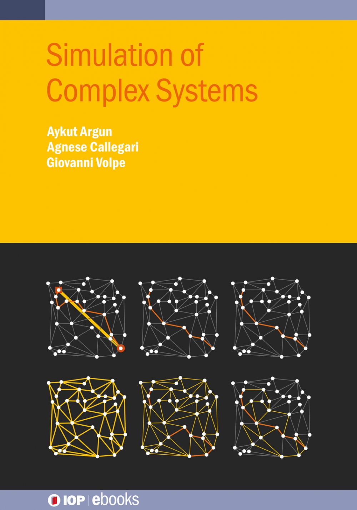

# FFR120-FYM119-course: Simulation of Complex Systems

  

by Aykut Argun, Agnese Callegari and Giovanni Volpe
IOP Publishing, 2021
ISBN: 978-0-7503-3843-1  
[https://iopscience.iop.org/book/mono/978-0-7503-3843-1](https://iopscience.iop.org/book/mono/978-0-7503-3843-1)  

---

*Simulation of complex systems* This book deals with the most fundamental and essential techniques to simulate complex systems, from the dynamics of molecules to the spreading of diseases, from optimization using ant colonies to the simulation of the Game of Life.

---

1. [**Molecular dynamics**](./Ch01_molecular_dynamics)  

2. [**Ising model**](./Ch02_ising_model)  
   

3. [**Forest fires**](./Ch03_forest_fires)  

5. [**Brownian dynamics**](./Ch04_brownian_dynamics)  
   

